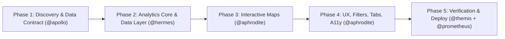
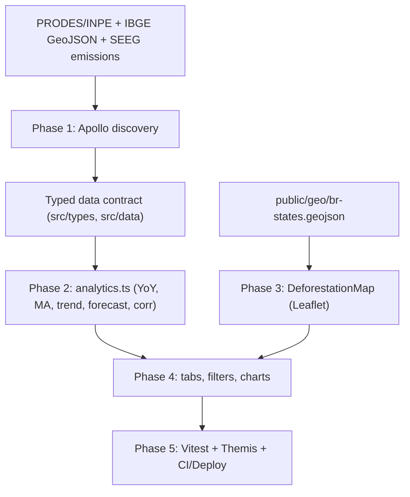

# 📐 Architecture Plan: Modernize br-deforestation Dashboard

> **Architect:** @athena · **Review Gate:** @themis · **Execution Mode:** Strict TDD with Sub-10s Test Slicing

### 📋 Executive Summary (Chat Contract)
- **Goal:** Evolve the PRODES/INPE deforestation panel into a richer, map-enabled, analytics-driven dashboard with forecasting, filters, tabs by biome, accessibility, Vitest coverage, and CI/deploy gates.
- **Estimated Effort:** ~5 phases / medium risk (frontend-only, static data, no backend/DB).

| Phase | Specialist | Key Deliverable | Test Slice |
|---|---|---|---|
| **1. Discovery & Data Contract** | @apollo | Dataset inventory, sources, licenses, GeoJSON feasibility | `npm run build` (sanity) |
| **2. Analytics Core & Data Layer** | @hermes | Stats utils (YoY, MA, trend, forecast, correlation) + typed datasets | `npx vitest run tests/analytics` |
| **3. Interactive Maps** | @aphrodite | Leaflet choropleth by state/biome | `npx vitest run tests/map` |
| **4. UX, Filters, Tabs, A11y** | @aphrodite | Biome tabs, filters, responsive, WCAG | `npx vitest run tests/components` |
| **5. Verification & Deploy** | @themis + @prometheus | Security/a11y review, coverage gate, CI, bundle budget | `npm run build && npx vitest run` |

### Goal, Scope & Context
- **Goal:** Modernize `/home/ils15/dev/br-deforestation` panel with richer datasets, interactive maps, statistical analysis, simple forecasting, improved UX/filters/tabs, responsive + accessible UI, Vitest tests, and Themis gates — without a backend or database.
- **In scope:** Datasets (PRODES by-state history, MATOPIBA, emissions, DETER optional); interactive map (Leaflet) choropleth; analytics (YoY %, MA 3/5y, linear trend, linear-regression forecast 3-5y labeled estimate, Pearson correlation); UX tabs by biome, year-range & state filters, KPI cards, responsive, WCAG 2.1 AA; tests Vitest + Themis; CI GitHub Actions; bundle budget.
- **Out of scope:** Backend/API, database, auth, real-time ingestion, ML beyond linear projection, SSR.
- **Assumptions & Open Questions:** Static data committed; refresh manual per PRODES release. GeoJSON IBGE needs download + simplification. react-leaflet v5/React 19 compat to verify. Emissions source (SEEG/INPE) license to verify. DETER optional stretch. Forecast labeled "projeção linear (estimativa)". Tailwind adoption open (recommend keep CSS vars).

### Phase 1 — Discovery & Data Contract (@apollo)
- Goal & Actions: inventory datasets, licenses, endpoints, GeoJSON sources; produce data contract (TS interfaces) + data/README.md provenance. Verify react-leaflet/React 19 compat.
- Affected: src/data/*.ts (new), public/geo/*.json (new), docs/data-sources.md (new).
- Dependencies: none (read-only).
- Tests: none; gate = documented sources + contract.
- Risks: unavailable endpoints → fallback static snapshots; mark gaps.

### Phase 2 — Analytics Core & Data Layer (@hermes)
- Goal & Actions (TDD): pure-TS analytics in src/lib/analytics.ts: yoyPct, movingAverage, linearTrend, forecast, pearsonCorrelation. Typed datasets src/data/*.ts (states history, MATOPIBA, emissions). Runtime validation (manual guards; optional zod).
- Affected: src/lib/analytics.ts, src/lib/analytics.test.ts, src/data/*.ts, src/types/data.ts.
- Dependencies: none new (pure TS). Optional zod.
- Tests: npx vitest run tests/lib/analytics.test.ts (<10s); tsc -b.
- Risks: incorrect formulas → golden-value tests against known PRODES totals; round 2 decimals.

### Phase 3 — Interactive Maps (@aphrodite)
- Goal & Actions: Leaflet choropleth component src/components/DeforestationMap.tsx (state polygons colored by year/biome metric, tooltip, legend, year slider). Lazy-load via React.lazy + Suspense. Add leaflet, react-leaflet, @types/leaflet.
- Affected: src/components/DeforestationMap.tsx, src/components/MapLegend.tsx, vite.config.ts (chunk group), src/index.css (leaflet css).
- Dependencies (npm): leaflet@^1.9, react-leaflet@^5, @types/leaflet. GeoJSON in public/geo/br-states.geojson.
- Tests: npx vitest run tests/components/DeforestationMap.test.tsx (mock leaflet); npm run build.
- Risks: bundle size → code-split; GeoJSON too large → simplify; mark unknown.

### Phase 4 — UX, Filters, Tabs, Accessibility (@aphrodite)
- Goal & Actions: Refactor App.tsx into tabbed shell (Amazônia / Cerrado / MATOPIBA / Comparativo) with shared filter bar (year range, biome, state multi-select). Responsive grid, keyboard nav, ARIA, focus management, reduced-motion. Migrate charts into tab panels; add analytics charts (YoY %, MA, forecast dashed line, correlation scatter). Remove DeforestationTab at end.
- Affected: src/App.tsx, src/components/tabs/*, src/components/Filters.tsx, src/components/KpiGrid.tsx, src/index.css, src/components/DeforestationTab.tsx (remove).
- Dependencies: none new.
- Tests: npx vitest run tests/components; manual a11y check; oxlint.
- Risks: regression in charts → snapshot/visual checks; Themis review.

### Phase 5 — Verification & Deploy (@themis + @prometheus)
- Goal & Actions: Themis: security (no secrets, safe tooltip rendering), dead code, a11y, coverage ≥70% on src/lib and components. Prometheus: GitHub Actions workflow (lint, typecheck, test, build), bundle budget, GitHub Pages deploy. Update README with provenance + run instructions.
- Affected: .github/workflows/ci.yml (new), vite.config.ts (budget), README.md, EXTERNAL_SKILLS.md.
- Dependencies (dev): vitest, @testing-library/react, @testing-library/jest-dom, jsdom, @vitest/coverage-v8.
- Tests: npm run lint && tsc -b && npx vitest run --coverage && npm run build.
- Risks: CI flakiness → pin versions; deploy base path preserved.

### Acceptance Criteria
- [ ] All 5 phases' test slices green; full npx vitest run green.
- [ ] tsc -b and oxlint 0 errors/warnings.
- [ ] npm run build succeeds; main bundle ≤ budget; map lazy-loaded.
- [ ] Map renders choropleth for ≥2 biomes/years with tooltips.
- [ ] Analytics utils ≥90% coverage with golden-value tests.
- [ ] Forecast clearly labeled linear estimate with horizon selector.
- [ ] Tabs/filters keyboard-accessible; no axe critical violations (manual).
- [ ] Themis review passed (security + a11y + dead code).
- [ ] CI workflow green on PR; GitHub Pages deploy works.
- [ ] Rollback plan documented and tested.

### Rollback & Contingency
- Failure trigger: build breaks, bundle exceeds budget by >20%, Themis blocks, or map <30 fps.
- Rollback: revert phase commit; keep DeforestationTab.tsx as fallback until Phase 4 ships; disable map via VITE_ENABLE_MAP=false; remove new deps. Data files additive and safe.

### Data Flow

### Unknowns (resolve in Phase 1, do not guess)
- Exact GeoJSON source/simplification.
- Emissions dataset endpoint & license.
- DETER inclusion decision.
- Tailwind adoption decision.
- zod adoption.
- Update cadence/ownership.
