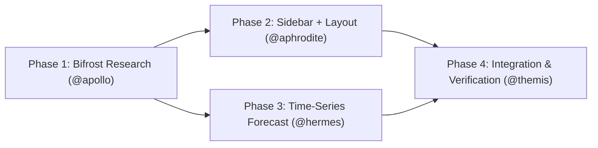

# 📐 Architecture Plan: Modernize BR Deforestation Dashboard (Sidebar + Statistical Forecasting)

> **Architect:** @athena · **Review Gate:** @themis · **Execution Mode:** Strict TDD with Sub-10s Test Slicing

## Executive Summary
- **Goal:** Replace the top-nav tab shell with an accessible sidebar navigation and upgrade the linear-only deforestation forecast to a statistically grounded time-series model (Holt/ETS with prediction intervals), keeping the Node/TS-only stack and PRODES data.
- **Estimated Effort:** 150–210 min · Medium risk (UI layout + analytics contract + test churn)

## Execution Flow

## Slice Table
| Phase | Specialist | Key Deliverable | Test Slice |
|---|---|---|---|
| 1. Research | @apollo | Bifrost findings: sidebar patterns + forecasting method | (read-only) |
| 2. UI / Layout | @aphrodite | `Sidebar` + app shell restructure | `npm test -- src/App.test.tsx` |
| 3. Forecasting | @hermes | Pure-TS time-series forecast + PI | `npm test -- src/lib/analytics.test.ts` |
| 4. Verification | @themis | Full gate + a11y + backtest report | `npm run lint && tsc -b && npm test && npm run build` |

## Goal, Scope & Context
- **Goal:** Modernize the dashboard UX (sidebar navigation) and make deforestation projections statistically realistic (trend + damping + prediction intervals) instead of naive linear extrapolation, with zero new runtime dependencies.
- **In scope:** Persistent sidebar on desktop, drawer on mobile; active view switching preserved. Bifrost research (Apollo) for sidebar UX and forecasting method selection. New pure-TypeScript time-series forecasting module with point forecasts + 80/95% prediction intervals. Update ComparativoPanel to use the new model and display intervals + method note. Update tests and docs to reflect the new shell and forecast contract.
- **Out of scope:** backend/data pipeline, new data sources (SEEG), i18n, map library swap, deployment infra.
- **Assumptions & Open Questions:** Node/TS only (no Python/statsmodels runtime); keep recharts, no new deps by default. PRODES annual series (Amazônia 2006–2026, Cerrado 2018–2026) are the only inputs. Keep legacy forecast() (linear) for backward compatibility; add a new function rather than mutating it. Unknown (research): final sidebar IA/iconography and whether top NavBar is fully replaced or retained as compact header. Unknown (research): forecasting method (Holt damped-trend vs. ETS vs. ARIMA) and seasonality handling for annual data. Unknown: filter placement (sidebar footer vs. top toolbar) and whether to expose a model selector in the UI.

## Phase 1 — Bifrost Research (@apollo, read-only, ≤8 min)
- Goal & Actions: Use Bifrost browser research to collect (a) sidebar navigation patterns for data dashboards (collapsible groups, active state, keyboard nav, responsive drawer) and (b) time-series forecasting best practices for short annual environmental series (Holt-Winters/ETS/ARIMA, damping, backtesting, prediction intervals). Summarize findings + recommended defaults; no code edits.
- Affected: none (research output feeds Phase 2/3)
- Dependencies: none
- Tests: n/a (read-only)
- Risks: research may be inconclusive → fall back to documented defaults (Holt damped trend, sidebar primary + mobile drawer).

## Phase 2 — Sidebar + Layout (@aphrodite)
- Goal & Actions: Create src/components/Sidebar.tsx (desktop persistent, vertical nav items with active state, keyboard support) and restructure src/App.tsx to a sidebar+content grid; retain MobileDrawer for small screens (reuse existing focus trap). Decide top-header retention per Apollo findings. Update App.test.tsx selectors to the new shell (tablist preserved inside content or converted to sidebar nav — TBD by research, default: keep tablist as view switcher within main content and add sidebar for section navigation). Preserve SkipLink, KPI strip, map panel.
- Affected: src/App.tsx, new src/components/Sidebar.tsx (+ test), src/components/NavBar.tsx, src/components/MobileDrawer.tsx, src/App.test.tsx, src/index.css (layout classes)
- Dependencies: Phase 1 findings
- Tests: npm test -- src/App.test.tsx (target <10s); update assertions, no weakening of a11y checks
- Risks: breaking existing tablist tests → migrate assertions in same phase; keep role-based queries where feasible.

## Phase 3 — Time-Series Forecasting (@hermes)
- Goal & Actions: Add src/lib/forecasting.ts (or extend analytics.ts) implementing timeSeriesForecast(series, horizon, options) returning point forecasts + lower/upper bounds (80/95%), using Holt's damped trend (default) with optional method selector; clamp negatives to 0; handle short series. Add backtesting helper (backtest(series, holdout)) reporting MAE/RMSE/MAPE. Keep forecast() (linear) intact. Update ComparativoPanel to use the new model, render interval band, and show method + "estimativa" labeling. Add unit tests (golden + edge cases).
- Affected: src/lib/analytics.ts or new src/lib/forecasting.ts (+ tests), src/types/data.ts (forecast result type), src/components/ComparativoPanel.tsx, src/lib/chartTheme.ts (interval colors)
- Dependencies: Phase 1 method decision; no new npm deps
- Tests: npm test -- src/lib/analytics.test.ts (and new forecasting test file)
- Risks: short Cerrado series → disable seasonality, warn in UI; negative forecasts → clamp; golden test churn → update expectations in same PR.

## Phase 4 — Integration & Verification (@themis)
- Goal & Actions: Run full quality gate (lint, tsc, vitest, build), verify coverage ≥70% in src/lib and src/components, accessibility (keyboard nav, focus, ARIA), and review the backtest report. Confirm no regressions in map/filters/KPIs. Produce findings.
- Affected: all changed files
- Dependencies: Phases 2 and 3
- Tests: npm run lint && tsc -b && npm test && npm run build
- Risks: coverage drop → add targeted tests; a11y regressions → fix before merge.

## Acceptance Criteria
- [ ] Sidebar navigation visible on desktop; mobile drawer still functional.
- [ ] Active view switching + keyboard navigation (arrows/Home/End) works.
- [ ] Forecast uses time-series model with prediction intervals; chart displays historical + forecast + interval band.
- [ ] Backtest metrics (MAE/RMSE/MAPE) documented for both biomes.
- [ ] npm run lint && tsc -b && npm test && npm run build all green.
- [ ] Coverage ≥70% in src/lib and src/components.
- [ ] No new runtime dependencies added (unless research justifies and approved).

## Rollback & Contingency
- Failure trigger: Quality gate failure, a11y regression, or forecast producing invalid/negative ranges that can't be clamped sensibly.
- Rollback steps: Revert changed files; retain legacy forecast() (linear) as the active method in ComparativoPanel; restore previous App.tsx shell. Keep data untouched.

## Unknowns (explicit)
1. Sidebar IA (items, grouping, icons) — pending Apollo Bifrost research.
2. Forecasting method & parameters — pending research + backtesting.
3. Top nav retention vs. full replacement — pending research.
4. Filter placement and model selector in UI — open decision.
5. Exact test-selector updates for the new shell — to be finalized during Phase 2.
PLAN

## User Decisions (approved)
- Forecasting: implement all three methods (Holt damped-trend, ETS, ARIMA) and estimate for each; expose model selector in UI.
- Navigation: remove top nav completely (no duplication).
- Filters: place in sidebar footer.
- Model selector: yes, expose in UI.
