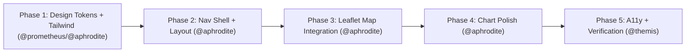

# 📐 Architecture Plan: Modernize UI/UX — BR Deforestation Dashboard

> **Architect:** @athena · **Review Gate:** @themis · **Execution Mode:** Strict TDD with Sub-10s Test Slicing

## Executive Summary
- **Goal:** Transform the BR Deforestation dashboard from a plain tabbed shell into a modern, responsive, accessible single-page experience with a polished navigation menu, an integrated Leaflet map in the main view, refined Recharts visualizations, and a Tailwind-based design system — without changing data or analytics logic.
- **Estimated Effort:** ~180–240 min across 5 phases (medium risk; touches most UI files and test selectors).

## Execution Flow

## Slice Table
| Phase | Specialist | Key Deliverable | Test Slice |
|---|---|---|---|
| 1. Design System | @prometheus + @aphrodite | Tailwind v4 wired, tokens, theme | `npm run lint && tsc -b` |
| 2. Nav Shell | @aphrodite | Responsive nav menu + grid layout | `npm test -- App.test.tsx` |
| 3. Map Integration | @aphrodite | Leaflet in main view, lazy, resize | `npm test -- DeforestationMap.test.tsx` |
| 4. Chart Polish | @aphrodite | Recharts styling/tooltips/legends | `npm test -- *Panel.test.tsx` |
| 5. Verification | @themis | A11y audit, coverage, build gate | `npm run lint && tsc -b && npm test && npm run build` |

## Goal, Scope & Context
- **Goal:** Modernize the visual/UX layer of `br-deforestation` (navigation menu, layout, integrated Leaflet map, polished charts, responsive, accessible) using React 19 + Vite 8 + Tailwind design system + Recharts + accessibility best practices, while preserving data, analytics, and existing behavior.
- **In scope:** Install/configure Tailwind CSS (v4) via @tailwindcss/vite; design tokens (@theme + CSS vars); responsive nav menu (top bar + mobile drawer) with keyboard support; new app shell (header, filter toolbar, KPI strip, main grid, footer); integrate Leaflet map into main view (lazy); polish Recharts (palette, tooltips, legends, grid, empty states, reduced-motion); accessibility (semantics, focus rings, skip link, ARIA, contrast, breakpoints); update tests/selectors without reducing coverage.
- **Out of scope:** Data changes, analytics logic, new metrics, backend/API, new chart types, dark/light toggle, deployment pipeline changes.
- **Assumptions & Open Questions:** (1) Tailwind adoption (not installed) — recommended adopt v4 with @tailwindcss/vite, keep CSS vars as fallback; confirm. (2) External skills documented but not installed; plan assumes install before Phase 1. (3) Navigation pattern: top nav + mobile drawer (vs sidebar). (4) Map placement: 2-col grid (charts left, map right) ≥1024px, stacked mobile; map height 320-480px. (5) Theme: dark only. (6) Tests: retain role="tablist" for biome switcher to minimize churn. (7) Vite 8 + Tailwind v4 compat unverified; fallback v3+PostCSS. (8) react-leaflet Hippocratic license note.

## Phases
### Phase 1 — Design System & Tooling (@prometheus + @aphrodite)
- Install external skills if approved; add tailwindcss, @tailwindcss/vite; wire plugin in vite.config.ts; create src/styles/tokens.css (@theme) migrating CSS vars; verify lint/tsc/build.
- Affected: package.json, vite.config.ts, src/index.css, src/styles/tokens.css.
- Risks: Tailwind/Vite incompatibility → fallback v3+PostCSS.

### Phase 2 — Navigation Shell & Layout (@aphrodite)
- Build NavBar (desktop) + MobileDrawer + SkipLink with keyboard support, focus trap.
- Refactor App.tsx: header with brand+nav, filter toolbar, KPI strip, main grid, footer.
- Preserve role="tablist" for biome switcher (minimize test churn). Responsive breakpoints.
- Update App.test.tsx selectors if needed (no coverage reduction).
- Affected: src/App.tsx, NavBar.tsx, MobileDrawer.tsx, SkipLink.tsx, index.css, App.test.tsx.
- Risks: breaking tab tests → keep tablist role; run tests before/after.

### Phase 3 — Leaflet Map Integration into Main View (@aphrodite)
- Embed DeforestationMap (lazy) in main view grid; extract useMapData(filters) hook; handle resize (invalidateSize); remove/deprecate standalone Mapa tab; keep loading fallback data-testid.
- Affected: src/App.tsx, MapaPanel.tsx (refactor/deprecate), DeforestationMap.tsx, new src/hooks/useMapData.ts, tests.
- Risks: map height collapse in flex/grid → explicit min-height; lazy chunk already configured.

### Phase 4 — Chart Polish (@aphrodite)
- Apply shared chart theme (colors from tokens, grid, axes, tooltip); consistent ResponsiveContainer heights; empty states; pt-BR number formatting; aria-label/role="img" on chart containers.
- Affected: AmazoniaPanel, CerradoPanel, MatopibaPanel, ComparativoPanel, KpiGrid, new src/lib/chartTheme.ts.
- Risks: Recharts v3 API changes → verify against 3.10.1; keep changes minimal.

### Phase 5 — Accessibility & Verification (@themis)
- Audit WCAG 2.2: contrast, focus order, keyboard nav, screen-reader labels, reduced-motion.
- Add skip link, focus-visible, aria-live for KPI updates (optional).
- Full gate: lint, tsc, test, build. Update README if structure changed.
- Affected: all touched components, index.css, README.md.
- Risks: coverage threshold 70% on src/lib and src/components → ensure new components have tests.

## Acceptance Criteria
- [ ] npm run lint → 0 warnings
- [ ] tsc -b → no errors
- [ ] npm test → all passing; coverage ≥70% on src/lib and src/components
- [ ] npm run build → success; chunk split intact
- [ ] Navigation menu renders on desktop and mobile; keyboard navigable (Tab, Enter, Esc closes drawer)
- [ ] Leaflet map renders in main view (lazy) and resizes correctly
- [ ] Charts render with consistent theme and tooltips; reduced-motion respected
- [ ] No regression in filters/KPIs/analytics behavior
- [ ] Accessibility: skip link, focus rings, ARIA labels, contrast ≥4.5:1 for text

## Rollback & Contingency
- Failure trigger: Tailwind/Vite incompatibility, coverage drop <70%, or broken map rendering after Phase 3.
- Rollback: revert Phase 1 commit (remove Tailwind, restore index.css) no data impact; keep tabbed shell fallback (retain Mapa tab if integration fails; don't delete MapaPanel until Phase 3 verified); use git revert per phase commit.
- Contingency: if Tailwind blocked, proceed with CSS-variable design tokens only and still deliver nav/layout/map/chart polish.

## Unknowns (marked)
- Git repo status (env says no git repo) — confirm.
- node_modules absent — install needed.
- External skills not installed on disk — install before Phase 1.
- Vite 8 + Tailwind v4 compatibility.
- Light-theme desire.
- Branching/CI workflow absent despite README mention.
PLAN